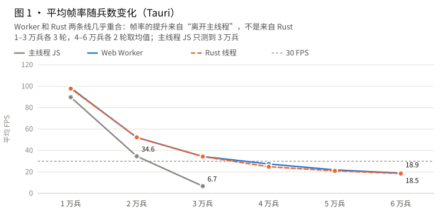
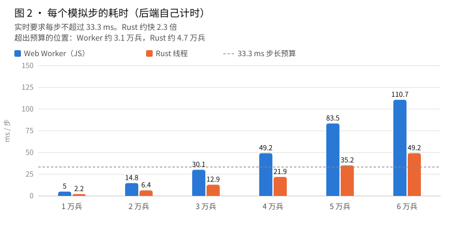
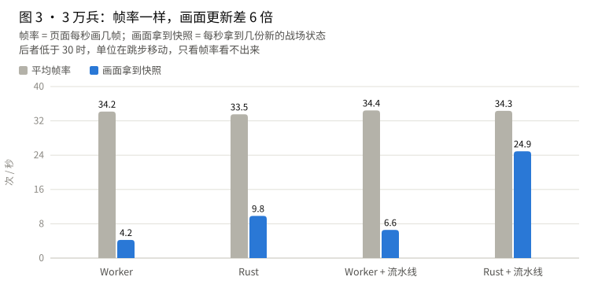

# 对比实验报告：Tauri 做图形应用的边界在哪

测试日期 2026-11-13 / 14（外壳对比），2026-11-17（模拟后端对比、IPC 基准）。机器：i9-14900HX，RTX 4060 Laptop，32GB，2560×1600 @ 240Hz（系统缩放 150%），Windows 11。

被测对象是「城邦演武」v3：一个纯 Canvas 2D 的即时战略游戏，逐士兵模拟，地图最大 200×125 格、8 方、上万士兵。同一份页面分别放进 Tauri 2（WebView2）、Electron 45 和 Edge 里跑同一套压力测试，另外拿改造前的版本做前后对比。测试方法和原始数据见文末与 `bench/results/`。文中的图由 `node tools/report.js` 从原始数据生成，放在 `bench/figs/`（图片路径相对于仓库根目录的报告文件）。

## 研究问题

1. 用 Tauri 做一个重图形负载的桌面应用，**外壳本身**（WebView2 + 宿主进程）会不会带来性能损失？和 Electron、和直接用浏览器比怎样？
2. 负载加上去以后，**最先撞到的是哪一面墙**：GPU、外壳、还是页面里的 JS？墙在多少士兵处？
3. Tauri 和 Electron 最大的结构差别是“可以把重活放到 Rust 里”。**把模拟搬到 Rust 线程以后，墙能往外推多远？代价（Rust↔JS 传数据）有多大？** 这个提升里有多少只是“离开了主线程”带来的、和 Rust / Tauri 无关？

## 结论适用范围

- 一台机器（i9-14900HX + RTX 4060 Laptop，Windows 11），Tauri 2 + WebView2（Chromium 157）。macOS / Linux 上 Tauri 换成 WKWebView / WebKitGTK，结论不能外推。
- 渲染只用了 Canvas 2D，没有 WebGL / WebGPU。
- 负载是“逐士兵模拟 + 逐个画精灵”的即时战略，主线程上模拟和绘制都很重。纯 UI 类应用的瓶颈形态不同。
- Rust 后端只移植了压力测试用到的路径，经逐秒对拍证明和 JS 版逻辑等价（见第 10 条）。

## 这次测到的是哪一维边界

| 维度 | 测了没有 | 在哪一节 |
|---|---|---|
| 外壳开销（同一页面换外壳） | 测了 | 结论 1–2 |
| 页面主线程 JS 的上限（兵数 → 帧率） | 测了 | 结论 3–4 |
| 稳定性、内存、体积、启动 | 测了 | 结论 5–6 |
| 模拟离开主线程（Worker 对照 Rust）后的上限 | 测了 | 结论 9–10 |
| Rust↔JS 的 IPC 带宽与延迟 | 测了（空载基准 + 实际负载中） | 结论 11 |
| GPU 光栅化上限 | 只间接看到（帧率里），没有单独测 | — |
| WebGL / WebGPU、其他操作系统 | 没测 | — |

## 摘要

- **Tauri 这层壳不是瓶颈。** 从 3000 兵到 3 万兵，Tauri 和同内核的 Edge 帧率差距不超过 3%；两边都重复过三次的档位里不超过 1%，小于测量波动。
- **边界由页面自己的单线程 JS 决定。** 在本机上，Tauri 约 7600 兵以内保持 120 FPS，约 1.4 万兵跌破 60 FPS，约 2.1 万兵跌破 30 FPS，3 万兵只剩 8 FPS。此时主线程 99% 的时间花在页面的模拟和绘制指令上，三个外壳的结果一样。
- **Electron 在同样负载下慢 12–17%**，差距是波动的好几倍。两者 JS 执行速度基本相同，Electron 多出来的时间在页面 JS 之外（光栅化、合成、呈现）。
- **稳定性**：8 分钟浸泡 Tauri 没有一帧超过 33ms，没有脚本错误，内存在缓存填满后持平。
- **把模拟搬离主线程，帧率的墙从约 2.1 万兵推到约 3.4 万兵**（30 FPS 线）。这个提升来自“离开主线程”本身：同一份 JS 放进 Web Worker 和移植到 Tauri 的 Rust 线程，帧率在每一档都一样，Edge 里的 Worker 也一样。新的墙是主线程上的 Canvas 2D 绘制。
- **Rust 的优势在算力**：同一算法约快 2.3 倍，模拟能在实时速度下撑到约 4.7 万兵（Worker 里的 JS 约 3.1 万）。
- **Tauri 独有的代价在 IPC 延迟**：二进制通道约 140 MB/s，带宽够用；但主线程忙时，一份 0.3–1 MB 的快照要 28–78ms 才能回到页面（空载的 8–9 倍），“一问一答”时画面每秒只更新 10–23 次，帧率却看不出来。页面同时挂 3 个请求后恢复到 25–30 次/秒。3 万兵时 Rust + 流水线是唯一帧率、模拟速度、画面更新都达标的配置。
- **有一个没查明的问题**：两批实验里都有轮次整轮失效（窗口停止出帧、CPU 很低），三个外壳都出现过，集中在主线程过载的档位，原因没有定位。详见“一个没查明的现象”。

## 结论

**1. Tauri 的图形性能和同内核的 Edge 持平。**
大地图 6 方混战，每个配置独立跑三次（平均 FPS，均值 ± 标准差）：

| 士兵数 | Tauri | Edge | Electron | Electron 相对 Tauri |
|---:|---:|---:|---:|---:|
| 3000 | 202.9 ± 2.4 | 204.3 ± 1.1 | 178.4 ± 1.0 | −12.1% |
| 6000 | 139.4 ± 2.0 | 138.7 ± 3.5 | 118.5 ± 2.2 | −15.0% |
| 10000 | 91.9 ± 0.3 | 91.7 ± 1.3 | 78.7 ± 0.8 | −14.4% |
| 15000 | 56.8 ± 0.1 | 56.8（单次） | 49.8（单次） | −12.3% |
| 20000 | 36.0 ± 0.4 | 37.1（单次） | 30.0 ± 1.0 | −16.7% |
| 30000 | 8.2 ± 0.4 | 8.0（单次） | 7.2（单次） | −12.2% |

Tauri 和 Edge 用的是同一个 Chromium 157，3000 到 15000 兵四档差距不超过 1%，在波动范围内；2 万和 3 万兵 Edge 只跑了一次，差 2–3%。也就是说 WebView2 这层壳本身没有带来可测的图形开销。

**2. Electron 慢 12–17%，慢在页面 JS 之外。**
每个模拟步的耗时两者几乎一样（1 万兵时 Electron 4.93ms、Tauri 4.84ms），说明 JS 执行速度没有差别。差别在每帧里 JS 以外的部分：1 万兵时 Electron 每帧约 3.6ms，Tauri 约 2.5ms；2 万兵时是 4.2ms 对 3.0ms。分阶段看，差距集中在全图俯瞰（6000 兵时 79 对 121 FPS），近景差距小。Electron 45 自带的是 Chromium 156，比系统 WebView2 旧一个大版本；这个差距来自内核版本还是 Electron 的默认配置，本实验分不出来。

**3. 边界在哪：约 1.4 万兵以内流畅，约 2.1 万兵以内可用，再往上迅速崩塌。**
Tauri 继续加兵的结果（实际在场士兵数略低于目标值，因为兵在不断战死和补充）：

| 实际士兵数 | 平均 FPS | 最差 1% 帧的 FPS | 每个模拟步 ms（预算 33.3） | 主线程 JS 占帧时间 |
|---:|---:|---:|---:|---:|
| 9969 | 91.9 | 39.8 | 4.8 | 77% |
| 14902 | 56.8 | 26.6 | 8.7 | 84% |
| 19595 | 36.0 | 15.3 | 13.7 | 89% |
| 21998 | 27.1 | 11.4 | 16.8 | 94% |
| 24400 | 19.3 | 8.2 | 20.4 | 95% |
| 29304 | 8.2 | 4.0 | 27.1 | 99% |

按相邻档位线性插值：平均帧率在约 7600 兵跌破 120 FPS，约 14400 兵跌破 60 FPS，约 21200 兵跌破 30 FPS；最差 1% 的帧在约 13600 兵就跌破 30 FPS。

**4. 撞到的墙是单线程 JS，不是 GPU，也不是外壳。**
“主线程 JS 占帧时间”是模拟加上发绘制指令的耗时除以帧时间。它从 1000 兵的 29% 一路涨到 3 万兵的 99%，帧率越低，越是被页面自己的 JS 卡住。崩塌之所以快，是因为模拟耗时随兵数超线性增长（1 万兵到 3 万兵，兵数 2.9 倍，每步耗时 5.6 倍）。3 万兵时每个模拟步要 27ms，而实时步长只有 33ms，主线程 81% 的时间用来让模拟不掉队，剩下的只够每秒画 8 帧。

模拟速度在整个测试范围内都不低于实时的 98%，也就是说游戏本身没有变慢，牺牲的是帧率。按每步耗时外推，模拟本身跟不上实时大约在 3.3 万兵，这个数没有实测。

**5. 稳定性：Tauri 8 分钟浸泡没有一帧超过 33ms，没有脚本错误；内存在缓存填满后持平。**
4000 兵、8 分钟、近 8 万帧，最长一帧 25ms。进程树私有内存前半段从约 570MB 涨到约 740MB，后半段持平（737 → 755 → 746MB）；另一轮 5 分钟近景浸泡同样在约 650MB 处持平。Electron 和 Edge 的走势相同。加到 3 万兵时峰值私有内存约 1000MB，没有随兵数明显增长。需要说明的局限：两轮浸泡里地形缓存都没有涨到 44MP 的上限，所以“缓存淘汰”这条路径没有被实际触发过；8 分钟也不足以排除很慢的泄漏。

**6. 体积和内存：Tauri 的可执行文件 3.5MB，Electron 打包目录 357MB；运行时内存两者接近。**
停在标题页时进程树私有内存 Tauri 432MB、Electron 402MB、Edge 654MB。Tauri 的体积优势来自复用系统里的 WebView2，内存上没有优势。启动到可交互 Tauri 约 1.1–1.4 秒，Electron 约 0.85 秒。

**7. 改造本身：同屏约 2000 兵，新版比旧版快约 70%，同时多了光照、粒子、迷雾等特性。**
Tauri 里旧版 40 FPS，新版 69 FPS；Edge 是 42 对 70。新版 JS 侧耗时反而略高（11.2ms 对 9.8ms），帧率却更高，省下来的是 GPU 侧：所有精灵帧合进了一张图集，影子和脚环从逐个画路径改成了贴图。Electron 那一行旧版只投放到约 1600 兵，负载偏轻，不能直接比。

**8. 钱花在哪：旗标和血条最贵，LOD 最值，光照几乎免费。**
6000 兵时关掉旗标血条 137 → 178 FPS（俯瞰阶段 123 → 224）；关掉 LOD 则俯瞰阶段从 123 掉到 29 FPS；关掉昼夜光照没有可测的变化。旗标是用路径和文字逐个画的，下一步该把它也缓存成贴图。

**9. 把模拟搬离主线程：帧率的墙从约 2.1 万兵推到约 3.4 万兵，但 Rust 和 Worker 在帧率上没有差别。**
第二批实验把同一场战斗的模拟分别放在三处：主线程 JS（原样）、Web Worker（同一份 JS，对照组）、Tauri 的 Rust 线程（逐函数移植）。页面只负责每帧取一份快照、还原、画出来。Tauri 里各跑三次（平均 FPS，均值 ± 标准差）：

| 士兵数 | 主线程 JS | Web Worker | Rust 线程 | Rust 线程 + 流水线 |
|---:|---:|---:|---:|---:|
| 1 万 | 89.8 ± 1.7 | 98.7 ± 1.5（+10%） | 98.8 ± 1.0（+10%） | 97.8 ± 1.0 |
| 2 万 | 34.6 ± 1.3 | 50.1 ± 3.3（+45%） | 53.2 ± 1.0（+54%） | 52.3 ± 0.5 |
| 3 万 | 6.7 ± 0.5 | 34.2 ± 1.1（约 5 倍） | 33.5 ± 3.9（约 5 倍） | 34.3 ± 0.6 |

平均帧率跌破 30 FPS 的位置从约 2.12 万兵推到约 3.4–3.5 万兵；跌破 60 FPS 从约 1.5 万推到约 1.8 万。Edge 里的 Worker 结果和 Tauri 一样（1 万 / 2 万 / 3 万兵：100.2 / 51.4 / 34.7 FPS），所以**帧率提升来自“离开主线程”，和 Rust、和 Tauri 无关**。Rust 和 Worker 两列在每一档都落在彼此的波动范围内。

原因是模拟一离开主线程，主线程上剩下的就只有绘制：每帧发绘制指令的 JS 耗时 1 万兵 7ms、2 万兵 14ms、3 万兵 23ms、4 万兵 31ms、6 万兵 45ms，帧率直接由它决定，与模拟在哪算无关。**新的墙是主线程上的 Canvas 2D 绘制。**

**10. Rust 的优势在算力：同一算法单线程约快 2.3 倍，模拟能撑到约 4.7 万兵，Worker 只能到约 3.1 万。**
真实窗口里后端自己报的每步耗时：1 万兵 Worker 5.0ms 对 Rust 2.1ms，2 万兵 15.2 对 6.2ms，3 万兵 30.5 对 13.3ms，稳定在 2.3–2.4 倍（命令行里测的是 2.5 倍）。实时步长的预算是 33.3ms：Worker 在约 3.1 万兵超预算，4 万兵时每步 49ms、模拟只剩实时的 63%，5 万兵只剩 38%；Rust 在约 4.7 万兵超预算，4 万兵时每步 22ms、仍是实时的 99%，5 万兵 35ms、实时的 86%。也就是说，**能在实时速度下算多少兵**，Rust 是 JS 的约 1.5 倍。

Rust 移植的正确性用逐秒对拍验证：两边临时换用同一个 sin/cos 后，2 万兵 60 秒的 12 项指标逐秒完全一致；不换时前 10 秒一致，之后因为 V8 和 Rust 的 sin/cos 在约 0.9% 的输入上差最后一位而分叉，规模保持一致（士兵数偏差 0.6%）。

**11. Tauri 独有的代价在 IPC：带宽够用，延迟在主线程忙时被放大 8–9 倍。**
空载基准（页面不跑游戏，一次往返的中位数）：

| 数据量 | Tauri invoke 二进制（Rust→页面） | Tauri invoke JSON | 页面→Rust 二进制 | Worker postMessage 转移 |
|---:|---:|---:|---:|---:|
| 1 KB | 0.93 ms | 0.90 ms | 0.93 ms | < 0.1 ms |
| 256 KB | 3.1 ms | 6.5 ms | 4.1 ms | 0.2 ms |
| 1 MB | 8.8 ms | 23.7 ms | 14.1 ms | 0.5 ms |
| 16 MB | 111 ms | （没测） | 192 ms | 7.5 ms |

Tauri 的二进制通道吞吐约 140 MB/s，JSON 约 42 MB/s（慢 2.7 倍，大数据一定要走二进制响应）；每次调用有约 1ms 的固定开销。Worker 转移 ArrayBuffer 的耗时和“只造数据不发送”几乎相同，传递本身接近零成本。

带宽本身够用：3 万兵每秒 30 份快照约 30 MB/s，远低于 140 MB/s。问题在延迟：游戏跑起来以后，一份快照从 Rust 回到页面要 1 万兵 28ms（336 KB，空载时这么大约 3.5ms）、2 万兵 48ms、3 万兵 78ms，因为回复要等页面主线程从渲染里腾出空才能处理。按“一问一答”取快照时，这段延迟让画面每秒只拿到 23 / 15 / 10 份新状态——**帧率看起来和 Worker 一样，单位实际在跳步移动**。只看 FPS 会得出错误结论，所以报告另列了“画面拿到快照 次/秒”。

缓解办法实测有效：页面同时挂 3 个请求（流水线），后端每算完一步就排一份，延迟被并发藏起来，画面更新恢复到 29.8 / 27.8 / 24.9 次/秒，帧率不变。Worker 加同样的流水线后 2 万兵以内是满 30 次/秒，但 3 万兵只有 6.6 次/秒——那里 Worker 自己已经算不过来，流水线救不了。**3 万兵时 Rust + 流水线是唯一一个帧率 30+、模拟实时、画面每秒更新 25 次的配置**，这是这次实验里 Rust + Tauri 唯一明确胜出的地方。代价是画面比模拟晚约 3 个模拟步（约 80ms），对观战无感，对操作响应会有影响（预计，没测）。

**12. 往上突破该做什么（预计，未实测）。**
- 帧率：墙已经是主线程的 Canvas 2D 绘制，下一步是 WebGL / WebGPU 批量绘制，或者把绘制放进 OffscreenCanvas + Worker。这和外壳无关，三个外壳都适用。
- Tauri IPC：快照做增量或量化（位置用 16 位）把体积压到几分之一；或者让流水线更深。也可以绕开 invoke，用本地 WebSocket 推数据，这条没测。
- 模拟：Rust 侧还是单线程，按区域并行可以继续往上推；JS 侧要靠 WASM 或多 Worker 才能追上。

## 一个没查明的现象

实验过程中有若干轮整轮失效：窗口停止正常出帧，进程树 CPU 占用只有 8–12%（正常是 170–220%），页面交不回结果。脚本把这类轮次判为无效并自动重跑。按外壳统计（不含启动测试，按尝试次数算）：

| 阶段 | Tauri | Electron | Edge |
|---|---:|---:|---:|
| 第一批实验（白天） | 17 轮 0 次 | 15 轮 4 次 | 17 轮 6 次 |
| 重复实验与极限档位（夜间） | 24 轮 2 次 | 17 轮 3 次 | 12 轮 0 次 |
| 合计 | 41 轮 2 次 | 32 轮 7 次 | 29 轮 6 次 |

夜间这一批的 5 次失效全部出现在 2 万兵及以上的档位（Electron 2 万兵连续 3 次，Tauri 3 万兵和 2.5 万兵各 1 次），1.5 万兵及以下的 32 轮没有出现。但它不是必现的：Electron 2 万兵随后重跑三次全部成功，Tauri 失效的两轮重跑一次就成功。

第二批实验（2026-11-17，模拟后端对比，80 次尝试，含 5 轮 IPC 基准）又出现 5 次，全部在 2 万兵及以上：

| 模拟跑在 | 2 万兵及以上的尝试次数 | 失效 |
|---|---:|---:|
| 主线程 JS（Tauri 2 次，Edge 3 万兵连续 2 次） | 12 | 4 |
| Worker / Rust（含流水线、4–6 万兵） | 39 | 1 |
| 1 万兵及以下（全部配置） | 24 | 0 |

主线程过载的档位失效率明显更高，但样本少，只能算线索。唯一一次 Rust 后端的失效有个有用的特征：整棵进程树的 CPU 是 35%，而不是其他失效轮次的 5–10%——多出来的正好是 Rust 模拟线程（每步 6ms，约 0.2 个核）加宿主进程。也就是说**失效时 Tauri 宿主进程和它的 Rust 线程都还在正常跑，停下来的是 WebView 的渲染那一侧**。

已知的特征：失效在时间上成段出现；Electron 失效的那一轮里，进程树私有内存在测量中途约 10 秒内掉了约 300MB（752 → 448MB），之后一直不变。

已经排除的原因：
- 窗口被遮挡。专门做了遮挡测试，三个外壳被盖住后都照常出帧（数据表第七节）。
- 熄屏或锁屏。本机接电源时显示器关闭超时是 1 小时，系统日志里失效发生的那段时间没有显示或会话状态变化的事件。
- 页面脚本错误。战局按模拟步数逐步确定，如果是脚本错误应当每次必现。

没有排除的：渲染进程异常退出（给 Electron 加了进程退出原因的记录，但加上之后没有再复现，所以没抓到）、Windows 对进程的调度或显卡驱动层面的问题。

这个现象的原因不明，**不能据此比较三个外壳谁更稳定**。能说的只有：三个外壳都出现过；重负载下 Tauri 也会出现；出现后重跑即可恢复。对一个要交付的应用来说，这是需要继续查的风险点。

## 这次实验没有回答的问题

- 只测了一台机器、一块独显、Windows。集成显卡、macOS（WKWebView）和 Linux（WebKitGTK）上 Tauri 用的是完全不同的内核，结论不能外推。
- 只测了 Canvas 2D。WebGL / WebGPU 下各外壳的差距可能不一样。
- “JS 侧渲染耗时”不含 GPU 光栅化，后者只能从帧率间接看出来。
- 只有 3000 兵及以上的规模阶梯做了重复（Tauri 每档 2–3 次，Electron 和 Edge 部分档位只有 1 次）。巨型地图、前后对比、消融和浸泡都只跑了一轮。
- 同一批实验内三次重复的标准差不到 2%，但隔了几个小时的两批实验之间，同一配置差了 6–10%（1 万兵 Tauri 第一批 86 FPS，重复实验 91.9 FPS）。两批之间补兵节奏有改动，战局不完全相同，机器状态也可能不同。所以绝对数值应按 ±10% 理解；外壳之间的相对比较是在同一批里交替跑的，更可靠。
- 边界数值取决于这台机器的单核性能。换一台机器，绝对兵数会变，“瓶颈在单线程 JS”这个结论是否成立也需要重测。
- 浸泡最长 8 分钟。
- 模拟后端对比只在 Tauri 里做了三次重复，Edge 每档一次，Electron 只做了 3000 兵的冒烟（Worker 能用）。没有试 Electron 里接原生模块跑 Rust 的做法，所以“只有 Tauri 能把模拟放进 Rust”不成立，能说的是 Tauri 做起来最直接、IPC 代价如上。
- 没加流水线的 Worker / Rust 只测到 3 万兵；4–6 万兵只测了加流水线的两种，各两次。
- “画面拿到快照 次/秒”反映的是画面更新的节奏，没有测输入到画面的延迟。
- IPC 基准是空载测的；负载下的延迟只有实际取快照这一种数据量和节奏。

## 方法

- 压力测试里所有归属方都由 AI 托管，据点打不坏，兵死了按模拟步数补充，所以各外壳里的战局逐步一致，负载稳定。
- 相机脚本：近景沿 8 字巡游（持续烘焙新地形块）→ 拉远 → 全图俯瞰（所有兵都在屏幕里）→ 中景。每轮测量 30 秒。
- 每轮新开进程，页面把结果 POST 回本地服务；脚本每 2 秒采样一次整棵进程树的工作集、私有内存和 CPU 时间。
- 模拟固定每秒 30 步。帧太长时一帧里会连跑多步来追上实时（最多 10 步），所以负载过重时先掉的是帧率，最后才是模拟速度。
- Tauri 加载的是嵌进可执行文件的页面，Electron 读本地文件，Edge 走本地 HTTP；改造前的页面三个外壳都走本地 HTTP。
- 三个外壳的窗口内容区都是 1360×900，画布 2040×1128。
- 模拟后端：Worker 和 Rust 都按实时节奏自己跑模拟，页面每帧最多取一次快照（二进制，约每兵 34 字节），还原进一个镜像世界后照常渲染，渲染代码不变。“一问一答”：页面发请求，后端等下一个模拟步算完再回；“流水线”：页面同时挂 3 个请求，后端每算完一步排一份，每份只交给一个请求，事件不重复不丢。快照传输耗时 = 请求往返 − 后端等下一步的时间。
- IPC 基准：`?ipc=1` 页面，1 KB 到 16 MB 每档往返 10–60 次（先热身 3 次），对方每次现造一块数据（逐字节填值）。Tauri 那边用 `invoke` 的二进制响应（`tauri::ipc::Response`）、默认 JSON 和二进制请求体三种。
- 第二批实验中途为了加流水线改过一次 `simworker.js` / `remote.js`（Edge 直接读这些文件），改动在单个请求时行为不变。
- 复现：`npx tauri build --no-bundle`、`npm --prefix electron run pack`、`node tools/experiment.js all`、`node tools/experiment.js repeat`、`node tools/experiment.js limit`、`node tools/experiment.js backend`、`node tools/experiment.js backpipe --only=tauri`、`node tools/experiment.js backlimit --only=tauri --sims=workerp,rustp`、`node tools/experiment.js ipc`、`node tools/report.js`。

---

# 数据表

## 测试环境

- 显卡：ANGLE (NVIDIA, NVIDIA GeForce RTX 4060 Laptop GPU (0x000028E0) Direct3D11 vs_5_0 ps_5_0, D3D11)
- 画布：2040x1128（窗口内容区 1360×900，系统缩放 1.5）
- Tauri (WebView2)：Chromium 157.0.0.0
- Electron：Electron 45.2.1，Chromium 156.0.8078.75
- Edge 浏览器：Chromium 157.0.0.0
- 三个外壳加了同样的开关，窗口被遮挡或失焦时不降帧；每轮测试都是新开进程、测完杀掉
- 帧率上限由显示器刷新率决定（本机 240Hz）；“JS 侧渲染耗时”只是发绘制指令的时间，GPU 光栅化的开销体现在帧率和帧时间里

## 启动、空闲占用与体积

| 外壳 | 进程启动→页面可交互 ms（三次） | 页面内启动 ms | 其中图集合成 ms | 空闲私有内存 MB | 空闲工作集 MB | 进程数 | 程序体积 |
|---|---:|---:|---:|---:|---:|---:|---:|
| Tauri (WebView2) | 1394 / 1100 / 1076 | 339 | 284 | 432 | 608 | 7 | 3.7 MB |
| Electron | 868 / 809 / 853 | 431 | 382 | 402 | 498 | 4 | 357.1 MB |
| Edge 浏览器 | 914 / 899 / 938 | 535 | 306 | 654 | 1014 | 17 | （系统自带） |

停在标题页约 9 秒的平均值。内存是整棵进程树之和（Tauri = 宿主 + WebView2 的全部子进程）。Tauri 依赖系统里已装的 WebView2 运行时，Electron 自带一整套 Chromium。Edge 有系统级的启动加速，启动时间仅供参考。

## 一、规模阶梯：三个外壳在同一负载下的表现

| 场景 | 外壳 | 平均 FPS | 1% Low | P99 帧 ms | 最长帧 ms | 卡顿帧 >33 / >100ms | 模拟 ms/帧 | 渲染 ms/帧(JS) | CPU % | 峰值私有内存 MB | JS 堆 MB |
|---|---:|---:|---:|---:|---:|---:|---:|---:|---:|---:|---:|
| 1000 兵 | Tauri (WebView2) | 237.7 | 227.3 | 4.4 | 16.8 | 0 / 0 | 0.06 | 1.16 | 125 | 879 | 8.4 |
| 1000 兵 | Electron | 233.2 | 119.0 | 8.4 | 20.8 | 0 / 0 | 0.06 | 1.15 | 176 | 790 | 13.6 |
| 1000 兵 | Edge 浏览器 | 237.1 | 227.3 | 4.4 | 41.7 | 1 / 0 | 0.05 | 1.14 | 138 | 957 | 5.6 |
| 3000 兵 | Tauri (WebView2) | 201.9 | 80.6 | 12.4 | 20.9 | 0 / 0 | 0.17 | 2.13 | 185 | 881 | 21.0 |
| 3000 兵 | Electron | 177.5 | 80.0 | 12.5 | 25.1 | 0 / 0 | 0.19 | 2.09 | 213 | 848 | 14.5 |
| 3000 兵 | Edge 浏览器 | 201.3 | 80.6 | 12.4 | 37.4 | 1 / 0 | 0.17 | 2.13 | 197 | 991 | 12.3 |
| 6000 兵 | Tauri (WebView2) | 137.8 | 59.5 | 16.8 | 33.4 | 0 / 0 | 0.56 | 4.10 | 210 | 940 | 37.5 |
| 6000 兵 | Electron | 117.9 | 48.1 | 20.8 | 33.3 | 0 / 0 | 0.67 | 4.17 | 218 | 866 | 13.6 |
| 6000 兵 | Edge 浏览器 | 139.3 | 59.9 | 16.7 | 29.2 | 0 / 0 | 0.55 | 4.01 | 225 | 980 | 33.1 |
| 10000 兵 | Tauri (WebView2) | 86.0 | 39.4 | 25.4 | 46.2 | 13 / 0 | 1.73 | 7.29 | 211 | 935 | 33.9 |
| 10000 兵 | Electron | 71.6 | 34.1 | 29.3 | 50.1 | 16 / 0 | 2.17 | 7.85 | 215 | 872 | 13.6 |
| 10000 兵 | Edge 浏览器 | 86.6 | 39.7 | 25.2 | 41.8 | 12 / 0 | 1.72 | 7.29 | 217 | 967 | 33.4 |

大地图 144×90 格（2880×1800 世界像素，51 座据点，6 方混战），30 秒相机脚本：近景巡游 → 拉远 → 全图俯瞰 → 中景。CPU % 是整棵进程树的 CPU 时间 ÷ 墙钟时间（100% = 占满一个逻辑核）。

分阶段帧率（平均 FPS / 1% Low）：

| 场景 | 外壳 | 近景巡游 | 拉远过程 | 全图俯瞰 | 中景 |
|---|---:|---:|---:|---:|---:|
| 1000 兵 | Tauri (WebView2) | 239.0 / 227.3 | 221.0 / 119.0 | 239.9 / 232.6 | 239.9 / 232.6 |
| 1000 兵 | Electron | 239.4 / 227.3 | 211.0 / 80.6 | 226.3 / 119.0 | 240.0 / 232.6 |
| 1000 兵 | Edge 浏览器 | 238.0 / 227.3 | 219.7 / 119.0 | 239.9 / 232.6 | 239.5 / 232.6 |
| 3000 兵 | Tauri (WebView2) | 238.6 / 227.3 | 167.3 / 59.9 | 202.5 / 119.0 | 167.8 / 117.6 |
| 3000 兵 | Electron | 233.5 / 120.5 | 151.7 / 59.5 | 132.6 / 80.0 | 159.8 / 114.9 |
| 3000 兵 | Edge 浏览器 | 238.5 / 232.6 | 163.7 / 59.9 | 203.5 / 119.0 | 166.2 / 111.1 |
| 6000 兵 | Tauri (WebView2) | 196.0 / 117.6 | 92.7 / 34.2 | 124.4 / 79.4 | 94.3 / 59.5 |
| 6000 兵 | Electron | 178.1 / 80.0 | 82.0 / 34.2 | 80.5 / 59.9 | 91.4 / 58.8 |
| 6000 兵 | Edge 浏览器 | 199.6 / 119.0 | 95.1 / 34.4 | 122.4 / 79.4 | 95.9 / 59.9 |
| 10000 兵 | Tauri (WebView2) | 126.7 / 59.9 | 59.6 / 21.8 | 73.2 / 48.3 | 57.1 / 39.4 |
| 10000 兵 | Electron | 108.1 / 59.5 | 50.1 / 20.0 | 49.4 / 39.8 | 54.9 / 39.4 |
| 10000 兵 | Edge 浏览器 | 126.2 / 59.9 | 60.3 / 23.9 | 74.3 / 48.1 | 58.3 / 39.5 |

## 一（续）、规模阶梯重复三次：均值与波动

| 场景 | 外壳 | 轮数 | 平均 FPS | 1% Low | P99 帧 ms | 卡顿帧 >33ms | 模拟 ms/帧 | 渲染 ms/帧(JS) | 模拟速度 % 实时 | 主线程 JS 占帧时间 % | 实际士兵数 | CPU % |
|---|---:|---:|---:|---:|---:|---:|---:|---:|---:|---:|---:|---:|
| 3000 兵 | Tauri (WebView2) | 3 | 202.9 ± 2.4 | 92.9 ± 21.4 | 11.1 ± 2.3 | 0 ± 0 | 0.17 ± 0.01 | 2.09 ± 0.04 | 100 ± 0 | 46 ± 0 | 3010 | 191 |
| 3000 兵 | Electron | 3 | 178.4 ± 1.0 | 80.0 ± 0.0 | 12.5 ± 0.0 | 0 ± 0 | 0.19 ± 0.00 | 2.07 ± 0.02 | 100 ± 0 | 40 ± 0 | 3009 | 205 |
| 3000 兵 | Edge 浏览器 | 3 | 204.3 ± 1.1 | 105.3 ± 21.4 | 9.8 ± 2.3 | 0 ± 0 | 0.16 ± 0.00 | 2.09 ± 0.01 | 100 ± 0 | 46 ± 0 | 3010 | 200 |
| 6000 兵 | Tauri (WebView2) | 3 | 139.4 ± 2.0 | 59.9 ± 0.0 | 16.7 ± 0.0 | 0 ± 1 | 0.55 ± 0.02 | 3.98 ± 0.08 | 100 ± 0 | 63 ± 0 | 5996 | 214 |
| 6000 兵 | Electron | 3 | 118.5 ± 2.2 | 51.8 ± 6.4 | 19.5 ± 2.3 | 1 ± 1 | 0.66 ± 0.02 | 4.10 ± 0.11 | 100 ± 0 | 56 ± 0 | 5996 | 215 |
| 6000 兵 | Edge 浏览器 | 3 | 138.7 ± 3.5 | 59.9 ± 0.0 | 16.7 ± 0.0 | 0 ± 1 | 0.55 ± 0.03 | 4.03 ± 0.14 | 100 ± 0 | 64 ± 1 | 5997 | 223 |
| 10000 兵 | Tauri (WebView2) | 3 | 91.9 ± 0.3 | 39.8 ± 0.2 | 25.1 ± 0.1 | 13 ± 2 | 1.58 ± 0.01 | 6.80 ± 0.02 | 100 ± 0 | 77 ± 0 | 9969 | 220 |
| 10000 兵 | Electron | 3 | 78.7 ± 0.8 | 34.2 ± 0.0 | 29.2 ± 0.0 | 13 ± 1 | 1.88 ± 0.02 | 7.18 ± 0.06 | 100 ± 0 | 71 ± 0 | 9968 | 218 |
| 10000 兵 | Edge 浏览器 | 3 | 91.7 ± 1.3 | 39.9 ± 0.1 | 25.1 ± 0.1 | 12 ± 2 | 1.56 ± 0.02 | 6.92 ± 0.09 | 100 ± 0 | 78 ± 0 | 9971 | 220 |

和上一节相同的场景，每个配置独立跑三次（每次都是新开进程），“±”后面是样本标准差。

Electron 相对 Tauri 的平均 FPS 差距：3000 兵 -12.1%（Edge 0.7%），6000 兵 -15.0%（Edge -0.5%），10000 兵 -14.4%（Edge -0.3%）。

分阶段平均 FPS（三次的均值 ± 标准差）：

| 场景 | 外壳 | 近景巡游 | 拉远过程 | 全图俯瞰 | 中景 |
|---|---:|---:|---:|---:|---:|
| 3000 兵 | Tauri (WebView2) | 238.6 ± 0.3 | 171.5 ± 1.7 | 206.1 ± 5.0 | 166.5 ± 3.4 |
| 3000 兵 | Electron | 234.6 ± 1.2 | 151.9 ± 1.5 | 133.5 ± 1.0 | 160.8 ± 1.3 |
| 3000 兵 | Edge 浏览器 | 238.7 ± 0.3 | 169.7 ± 1.9 | 208.6 ± 1.8 | 169.6 ± 1.6 |
| 6000 兵 | Tauri (WebView2) | 200.5 ± 4.3 | 94.9 ± 2.4 | 121.3 ± 2.3 | 96.5 ± 0.6 |
| 6000 兵 | Electron | 179.4 ± 3.9 | 84.1 ± 0.9 | 79.3 ± 1.0 | 92.3 ± 1.8 |
| 6000 兵 | Edge 浏览器 | 197.2 ± 6.0 | 95.9 ± 0.2 | 121.9 ± 5.4 | 97.1 ± 0.3 |
| 10000 兵 | Tauri (WebView2) | 138.1 ± 0.7 | 61.3 ± 0.4 | 76.6 ± 0.4 | 59.9 ± 0.9 |
| 10000 兵 | Electron | 124.1 ± 0.8 | 53.9 ± 0.8 | 51.9 ± 0.3 | 56.6 ± 1.3 |
| 10000 兵 | Edge 浏览器 | 134.8 ± 2.3 | 60.4 ± 1.3 | 80.6 ± 0.7 | 59.8 ± 1.6 |

## 一（再续）、极限档位：加到跑不动为止

| 场景 | 外壳 | 轮数 | 平均 FPS | 1% Low | P99 帧 ms | 卡顿帧 >33ms | 模拟 ms/帧 | 渲染 ms/帧(JS) | 模拟速度 % 实时 | 主线程 JS 占帧时间 % | 实际士兵数 | CPU % |
|---|---:|---:|---:|---:|---:|---:|---:|---:|---:|---:|---:|---:|
| 15000 兵 | Tauri (WebView2) | 3 | 56.8 ± 0.1 | 26.6 ± 0.1 | 37.6 ± 0.1 | 72 ± 9 | 4.60 ± 0.01 | 10.14 ± 0.05 | 100 ± 0 | 84 ± 0 | 14902 | 209 |
| 15000 兵 | Electron | 1 | 49.8 | 24.0 | 41.6 | 96 | 5.33 | 10.35 | 100 | 78 | 14899 | 212 |
| 15000 兵 | Edge 浏览器 | 1 | 56.8 | 26.6 | 37.6 | 64 | 4.53 | 10.17 | 100 | 84 | 14902 | 210 |
| 20000 兵 | Tauri (WebView2) | 3 | 36.0 ± 0.4 | 15.3 ± 1.0 | 65.5 ± 4.6 | 241 ± 12 | 11.42 ± 0.21 | 13.40 ± 0.12 | 100 ± 0 | 89 ± 0 | 19595 | 200 |
| 20000 兵 | Electron | 3 | 30.0 ± 1.0 | 13.6 ± 0.9 | 73.7 ± 4.9 | 401 ± 7 | 14.58 ± 0.95 | 14.53 ± 0.17 | 100 ± 0 | 87 ± 0 | 19597 | 207 |
| 20000 兵 | Edge 浏览器 | 1 | 37.1 | 16.0 | 62.5 | 228 | 10.76 | 13.22 | 100 | 89 | 19593 | 201 |
| 22500 兵 | Tauri (WebView2) | 2 | 27.1 ± 0.4 | 11.4 ± 0.0 | 87.5 ± 0.1 | 402 ± 16 | 18.59 ± 0.45 | 15.92 ± 0.10 | 100 ± 0 | 94 ± 0 | 21998 | 193 |
| 25000 兵 | Tauri (WebView2) | 2 | 19.3 ± 0.1 | 8.2 ± 0.2 | 123.1 ± 3.1 | 446 ± 8 | 31.66 ± 0.19 | 17.80 ± 0.02 | 100 ± 0 | 95 ± 0 | 24400 | 181 |
| 30000 兵 | Tauri (WebView2) | 3 | 8.2 ± 0.4 | 4.0 ± 0.1 | 248.6 ± 2.4 | 242 ± 12 | 98.67 ± 6.82 | 21.97 ± 0.04 | 99 ± 0 | 98 ± 1 | 29304 | 169 |
| 30000 兵 | Electron | 1 | 7.2 | 4.0 | 250.0 | 214 | 115.11 | 22.72 | 98 | 99 | 29297 | 173 |
| 30000 兵 | Edge 浏览器 | 1 | 8.0 | 4.0 | 250.0 | 240 | 101.49 | 22.19 | 99 | 99 | 29302 | 173 |

同一张大地图继续加兵。“模拟速度”= 实际跑的模拟步数 ÷ 实时应跑的步数（30 步/秒）；低于 100% 说明主线程已经来不及，游戏本身在变慢，此时 FPS 再高也没有意义。“主线程 JS 占帧时间”=（模拟 + 发绘制指令）÷ 帧时间，越接近 100% 说明帧率越是被页面自己的 JS 卡住，而不是 GPU 或外壳。各配置的轮数见表。

Tauri 的边界（由各档均值线性插值估算，实际士兵数为横轴）：

- 平均帧率跌破 120 FPS：约 7600 兵
- 平均帧率跌破 60 FPS：约 14400 兵
- 最差 1% 的帧跌破 30 FPS：约 13600 兵
- 平均帧率跌破 30 FPS：约 21200 兵
- 模拟跟不上实时（速度低于 95%）：测试范围内没有跌破

Tauri 各档的主线程时间去向（1000 兵取自第一节，3000–10000 兵取自重复实验）：

| 实际士兵数 | 轮数 | 平均 FPS | 帧时间 ms | 模拟 ms/帧 | 绘制 ms/帧(JS) | JS 占帧时间 % | 每个模拟步 ms | 占 33.3ms 步长预算 % |
|---|---:|---:|---:|---:|---:|---:|---:|---:|
| 1014 | 1 | 237.7 | 4.2 | 0.06 | 1.16 | 29 | 0.44 | 1 |
| 3010 | 3 | 202.9 | 4.9 | 0.17 | 2.09 | 46 | 1.13 | 3 |
| 5996 | 3 | 139.4 | 7.2 | 0.55 | 3.98 | 63 | 2.56 | 8 |
| 9969 | 3 | 91.9 | 10.9 | 1.58 | 6.80 | 77 | 4.83 | 14 |
| 14902 | 3 | 56.8 | 17.6 | 4.60 | 10.14 | 84 | 8.72 | 26 |
| 19595 | 3 | 36.0 | 27.8 | 11.42 | 13.40 | 89 | 13.74 | 41 |
| 21998 | 2 | 27.1 | 36.9 | 18.59 | 15.92 | 94 | 16.84 | 51 |
| 24400 | 2 | 19.3 | 51.9 | 31.66 | 17.80 | 95 | 20.39 | 61 |
| 29304 | 3 | 8.2 | 122.4 | 98.67 | 21.97 | 99 | 27.12 | 81 |

## 二、巨型地图（200×125 格，8 方，10000 兵）

| 场景 | 外壳 | 平均 FPS | 1% Low | P99 帧 ms | 最长帧 ms | 卡顿帧 >33 / >100ms | 模拟 ms/帧 | 渲染 ms/帧(JS) | CPU % | 峰值私有内存 MB | JS 堆 MB |
|---|---:|---:|---:|---:|---:|---:|---:|---:|---:|---:|---:|
| 200x125 · 99 据点 | Tauri (WebView2) | 131.3 | 47.6 | 21.0 | 41.6 | 1 / 0 | 1.12 | 3.62 | 196 | 1023 | 39.2 |
| 200x125 · 99 据点 | Electron | 127.0 | 47.8 | 20.9 | 33.4 | 1 / 0 | 1.07 | 3.19 | 197 | 994 | 14.5 |
| 200x125 · 99 据点 | Edge 浏览器 | 140.7 | 59.5 | 16.8 | 29.2 | 0 / 0 | 0.96 | 3.38 | 199 | 1071 | 17.6 |

| 外壳 | 近景巡游 | 拉远过程 | 全图俯瞰 | 中景 | 烘焙地形块 | 地形缓存 MP |
|---|---:|---:|---:|---:|---:|---:|
| Tauri (WebView2) | 182.2 / 60.2 | 152.8 / 40.0 | 70.6 / 34.2 | 118.4 / 48.8 | 114 | 36.2 |
| Electron | 182.8 / 79.4 | 148.4 / 40.2 | 52.0 / 40.0 | 121.9 / 59.2 | 114 | 36.2 |
| Edge 浏览器 | 192.2 / 79.4 | 160.1 / 48.1 | 80.2 / 48.1 | 127.6 / 59.5 | 114 | 36.2 |

## 三、改造前后对比（约 2000 兵全部在一屏内）

| 版本 | 外壳 | 平均 FPS | 1% Low | P99 帧 ms | 模拟 ms/帧 | 渲染 ms/帧(JS) | 士兵数 | CPU % | 峰值私有内存 MB |
|---|---:|---:|---:|---:|---:|---:|---:|---:|---:|
| 改造前（单屏 40×25） | Tauri (WebView2) | 40.4 | 34.1 | 29.3 | 0.89 | 9.76 | 1903 | 193 | 793 |
| 改造后（64×40，全图视角） | Tauri (WebView2) | 68.9 | 58.5 | 17.1 | 0.46 | 11.23 | 1973 | 223 | 582 |
| 改造前（单屏 40×25） | Electron | 35.7 | 29.9 | 33.5 | 0.71 | 5.03 | 1604 | 174 | 706 |
| 改造后（64×40，全图视角） | Electron | 55.6 | 47.6 | 21.0 | 0.55 | 10.38 | 1973 | 219 | 520 |
| 改造前（单屏 40×25） | Edge 浏览器 | 41.9 | 34.2 | 29.2 | 0.78 | 9.29 | 1959 | 206 | 946 |
| 改造后（64×40，全图视角） | Edge 浏览器 | 70.5 | 58.8 | 17.0 | 0.43 | 10.89 | 1974 | 226 | 764 |

改造前 = backup_v3 里的版本（每个精灵一张小画布、每个士兵用路径画影子和脚环、没有光照 / 粒子 / 迷雾）。改造后在 64×40 的小地图上把镜头拉到全图：这个缩放下 LOD 不会触发，2000 个兵全部按完整精灵画（带影子、脚环、旗标），另外还多了昼夜光照、粒子、云影和水面。改造前的页面由本地 HTTP 服务提供，三个外壳都从同一个地址加载。

## 四、画面特性消融（Tauri，大地图 6000 兵）

| 配置 | 平均 FPS | 1% Low | P99 帧 ms | 渲染 ms/帧(JS) | 近景 FPS | 俯瞰 FPS | 中景 FPS | CPU % |
|---|---:|---:|---:|---:|---:|---:|---:|---:|
| 全部开启 | 137.2 | 59.9 | 16.7 | 4.11 | 193.5 | 122.7 | 95.7 | 213 |
| 关 昼夜光照 | 136.3 | 59.5 | 16.8 | 4.14 | 192.4 | 120.9 | 96.1 | 210 |
| 关 粒子 / 天气 / 云影 / 水面 | 146.1 | 59.9 | 16.7 | 3.60 | 211.1 | 123.2 | 101.6 | 207 |
| 关 影子脚环 | 151.6 | 59.9 | 16.7 | 3.66 | 232.3 | 119.7 | 96.6 | 208 |
| 关 旗标血条 | 177.6 | 78.7 | 12.7 | 2.92 | 210.7 | 224.1 | 115.3 | 195 |
| 关 LOD（远景也画精灵） | 102.6 | 26.7 | 37.5 | 6.67 | 199.3 | 29.1 | 61.8 | 210 |

## 五、稳定性浸泡

| 外壳 | 时长 | 平均 FPS | 第 1 分钟 FPS | 最后 1 分钟 FPS | 1% Low | 最长帧 ms | 卡顿帧 >33 / >100ms | JS 堆 起→止 MB | 进程私有内存 前段→末段 MB | 脚本错误 |
|---|---:|---:|---:|---:|---:|---:|---:|---:|---:|---:|
| Tauri (WebView2) | 480 s | 166.1 | 222.8 | 123.8 | 78.7 | 25.4 | 0 / 0 | 10.7 → 30.0 | 606 → 762 | 0 |
| Electron | 480 s | 146.5 | 206.2 | 120.3 | 60.2 | 41.7 | 3 / 0 | 13.6 → 13.6 | 560 → 703 | 0 |
| Edge 浏览器 | 480 s | 171.7 | 223.7 | 129.2 | 79.4 | 29.2 | 0 / 0 | 9.1 → 17.3 | 633 → 769 | 0 |

大地图 4000 兵持续混战，相机在整段时间里慢速走完同一套脚本（近景 → 拉远 → 俯瞰 → 中景），所以帧率会随阶段变化；看稳定性主要看卡顿帧、内存走势和错误数。

每分钟平均 FPS：

| 外壳 | 第 1 分 | 第 2 分 | 第 3 分 | 第 4 分 | 第 5 分 | 第 6 分 | 第 7 分 |
|---|---:|---:|---:|---:|---:|---:|---:|
| Tauri (WebView2) | 223 | 231 | 210 | 133 | 125 | 124 | 157 |
| Electron | 206 | 214 | 187 | 107 | 86 | 100 | 149 |
| Edge 浏览器 | 224 | 232 | 204 | 135 | 138 | 144 | 164 |

进程树私有内存（MB），每约 10 秒一个点里抽样：

| 外壳 | 10% | 25% | 50% | 75% | 100% |
|---|---:|---:|---:|---:|---:|
| Tauri (WebView2) | 566 | 626 | 737 | 755 | 746 |
| Electron | 515 | 564 | 690 | 725 | 703 |
| Edge 浏览器 | 591 | 643 | 748 | 787 | 769 |

## 六、近景浸泡：内存是否封顶

| 外壳 | 时长 | 平均 FPS | 1% Low | 最长帧 ms | 卡顿帧 >33 / >100ms | 烘焙地形块 | 缓存 MP | 私有内存 20% | 40% | 60% | 80% | 结束 | 脚本错误 |
|---|---:|---:|---:|---:|---:|---:|---:|---:|---:|---:|---:|---:|---:|
| Tauri (WebView2) | 300 s | 215.7 | 117.6 | 24.9 | 0 / 0 | 20 | 25.2 | 539 | 610 | 651 | 659 | 647 | 0 |

相机全程贴近地面绕 8 字，不停地烘焙新的 1024×1024 地形块；缓存上限 44MP，超出才按最久未用淘汰 —— 这一轮只涨到表里的数值，没有触发淘汰。私有内存是整棵进程树之和（MB），按测试时间的百分位取样。

## 七、窗口被遮挡时

| 外壳 | 遮挡前（每 5 秒平均 FPS） | 遮挡后 |
|---|---:|---:|
| Tauri (WebView2) | 237 / 240 / 240 | 231 / 229 / 235 / 223 |
| Electron | 228 / 238 / 239 | 209 / 202 / 168 / 192 |
| Edge 浏览器 | 237 / 240 / 240 | 227 / 227 / 234 / 212 |

大地图 3000 兵近景，测量开始约 15 秒后弹出一个最大化、置顶的空窗口把测试窗口完全盖住。三个外壳都加了“被遮挡不降帧”的开关。

## 八、模拟后端对比：把模拟搬离主线程

| 场景 | 外壳 | 模拟跑在 | 轮数 | 平均 FPS | 1% Low | P99 帧 ms | 主线程模拟/还原 ms/帧 | 渲染 ms/帧(JS) | 每个模拟步 ms | 快照 KB | 快照传输 ms | 画面拿到快照 次/秒 | 模拟速度 % 实时 | 实际士兵数 | CPU % |
|---|---:|---:|---:|---:|---:|---:|---:|---:|---:|---:|---:|---:|---:|---:|---:|
| 10000 兵 | Tauri (WebView2) | 主线程 JS | 3 | 89.8 ± 1.7 | 39.8 ± 0.0 | 25.1 ± 0.0 | 1.66 ± 0.08 | 6.95 ± 0.14 | 4.98 ± 0.14 | – | – | – | 100 ± 0 | 9970 | 216 |
| 10000 兵 | Tauri (WebView2) | Web Worker（JS） | 3 | 98.7 ± 1.5 | 47.7 ± 0.1 | 20.9 ± 0.1 | 0.13 ± 0.00 | 6.94 ± 0.13 | 5.04 ± 0.12 | 337 ± 0 | 5.6 ± 0.0 | 29.9 ± 0.0 | 100 ± 0 | 9969 | 241 |
| 10000 兵 | Tauri (WebView2) | Rust 线程（Tauri IPC） | 3 | 98.8 ± 1.0 | 47.8 ± 0.0 | 20.9 ± 0.0 | 0.10 ± 0.00 | 6.85 ± 0.06 | 2.14 ± 0.03 | 336 ± 0 | 27.6 ± 0.3 | 23.2 ± 0.1 | 100 ± 0 | 9968 | 234 |
| 10000 兵 | Tauri (WebView2) | Web Worker + 流水线 | 3 | 98.4 ± 0.5 | 47.7 ± 0.2 | 21.0 ± 0.1 | 0.13 ± 0.00 | 6.95 ± 0.02 | 4.98 ± 0.07 | 337 ± 0 | 5.7 ± 0.2 | 30.0 ± 0.0 | 100 ± 0 | 9969 | 239 |
| 10000 兵 | Tauri (WebView2) | Rust 线程 + 流水线 | 3 | 97.8 ± 1.0 | 45.0 ± 3.9 | 22.3 ± 2.1 | 0.12 ± 0.00 | 6.91 ± 0.06 | 2.16 ± 0.07 | 336 ± 0 | 33.7 ± 0.6 | 29.8 ± 0.1 | 100 ± 0 | 9968 | 238 |
| 10000 兵 | Edge 浏览器 | 主线程 JS | 1 | 90.3 | 39.8 | 25.1 | 1.62 | 6.98 | 4.88 | – | – | – | 100 | 9970 | 223 |
| 10000 兵 | Edge 浏览器 | Web Worker（JS） | 1 | 100.2 | 47.6 | 21.0 | 0.13 | 6.90 | 4.99 | 337 | 5.5 | 30.0 | 100 | 9970 | 241 |
| 20000 兵 | Tauri (WebView2) | 主线程 JS | 3 | 34.6 ± 1.3 | 14.7 ± 0.5 | 67.9 ± 2.4 | 12.23 ± 0.81 | 13.72 ± 0.27 | 14.12 ± 0.40 | – | – | – | 100 ± 0 | 19594 | 194 |
| 20000 兵 | Tauri (WebView2) | Web Worker（JS） | 3 | 50.1 ± 3.3 | 25.0 ± 2.7 | 40.4 ± 4.7 | 0.42 ± 0.04 | 14.90 ± 1.03 | 15.21 ± 0.65 | 665 ± 0 | 12.0 ± 0.8 | 24.3 ± 0.7 | 100 ± 0 | 19597 | 258 |
| 20000 兵 | Tauri (WebView2) | Rust 线程（Tauri IPC） | 3 | 53.2 ± 1.0 | 25.8 ± 1.5 | 38.9 ± 2.3 | 0.23 ± 0.00 | 13.88 ± 0.21 | 6.23 ± 0.04 | 669 ± 0 | 48.3 ± 0.8 | 14.6 ± 0.1 | 100 ± 0 | 19612 | 245 |
| 20000 兵 | Tauri (WebView2) | Web Worker + 流水线 | 3 | 52.2 ± 0.8 | 26.6 ± 0.0 | 37.6 ± 0.0 | 0.48 ± 0.01 | 14.20 ± 0.18 | 14.79 ± 0.07 | 666 ± 0 | 13.7 ± 0.5 | 30.0 ± 0.0 | 100 ± 0 | 19595 | 261 |
| 20000 兵 | Tauri (WebView2) | Rust 线程 + 流水线 | 3 | 52.3 ± 0.5 | 26.6 ± 0.1 | 37.6 ± 0.1 | 0.43 ± 0.01 | 13.79 ± 0.15 | 6.44 ± 0.19 | 664 ± 0 | 57.4 ± 0.9 | 27.8 ± 0.1 | 100 ± 0 | 19612 | 254 |
| 20000 兵 | Edge 浏览器 | 主线程 JS | 1 | 34.9 | 14.9 | 67.1 | 11.94 | 13.84 | 13.91 | – | – | – | 100 | 19592 | 202 |
| 20000 兵 | Edge 浏览器 | Web Worker（JS） | 1 | 51.4 | 26.6 | 37.6 | 0.39 | 14.48 | 14.88 | 665 | 11.7 | 24.7 | 100 | 19597 | 262 |
| 30000 兵 | Tauri (WebView2) | 主线程 JS | 3 | 6.7 ± 0.5 | 4.0 ± 0.0 | 250.0 ± 0.0 | 125.42 ± 9.57 | 23.66 ± 0.59 | 28.81 ± 0.52 | – | – | – | 97 ± 1 | 29292 | 156 |
| 30000 兵 | Tauri (WebView2) | Web Worker（JS） | 3 | 34.2 ± 1.1 | 15.9 ± 4.3 | 66.7 ± 21.5 | 0.18 ± 0.00 | 23.37 ± 0.81 | 30.49 ± 0.66 | 1044 ± 3 | 87.6 ± 6.7 | 4.2 ± 0.4 | 96 ± 4 | 29315 | 293 |
| 30000 兵 | Tauri (WebView2) | Rust 线程（Tauri IPC） | 3 | 33.5 ± 3.9 | 16.9 ± 3.8 | 61.3 ± 15.6 | 0.40 ± 0.05 | 23.67 ± 3.03 | 13.29 ± 0.63 | 1018 ± 3 | 77.8 ± 7.9 | 9.8 ± 0.8 | 99 ± 0 | 29301 | 262 |
| 30000 兵 | Tauri (WebView2) | Web Worker + 流水线 | 3 | 34.4 ± 0.1 | 18.3 ± 0.1 | 54.4 ± 0.1 | 0.26 ± 0.00 | 23.02 ± 0.03 | 30.14 ± 0.16 | 1026 ± 1 | 91.8 ± 7.0 | 6.6 ± 0.2 | 98 ± 0 | 29315 | 289 |
| 30000 兵 | Tauri (WebView2) | Rust 线程 + 流水线 | 3 | 34.3 ± 0.6 | 18.9 ± 0.8 | 52.9 ± 2.3 | 0.92 ± 0.03 | 22.05 ± 0.40 | 12.95 ± 0.06 | 1001 ± 0 | 82.3 ± 1.1 | 24.9 ± 0.2 | 100 ± 0 | 29300 | 275 |
| 30000 兵 | Edge 浏览器 | 主线程 JS | 1 | 7.5 | 4.0 | 250.0 | 108.78 | 22.96 | 27.69 | – | – | – | 98 | 29299 | 171 |
| 30000 兵 | Edge 浏览器 | Web Worker（JS） | 1 | 34.7 | 18.5 | 54.1 | 0.18 | 22.92 | 29.34 | 1040 | 72.9 | 4.7 | 98 | 29318 | 295 |

“主线程模拟/还原”：主线程 JS 时是模拟本身的耗时；Worker / Rust 时模拟不在主线程上，这一列是把快照还原进镜像世界的耗时。“每个模拟步”：主线程 JS 按每帧模拟耗时折算；Worker / Rust 是后端自己报的。“快照传输”= 请求往返时间 − 后端等下一步算完的时间，含主线程忙于渲染、来不及处理回复的排队时间。“画面拿到快照 次/秒”低于 30 说明传输跟不上模拟，画面在跳步（模拟本身仍按实时跑）。

相对主线程 JS 的平均 FPS 提升（同一外壳内比较）：

| 场景 | 外壳 | 主线程 JS 的 FPS | Worker | Rust | Worker + 流水线 | Rust + 流水线 |
|---|---:|---:|---:|---:|---:|---:|
| 10000 兵 | Tauri (WebView2) | 89.8 | +10% | +10% | +10% | +9% |
| 10000 兵 | Edge 浏览器 | 90.3 | +11% | – | – | – |
| 20000 兵 | Tauri (WebView2) | 34.6 | +45% | +54% | +51% | +51% |
| 20000 兵 | Edge 浏览器 | 34.9 | +47% | – | – | – |
| 30000 兵 | Tauri (WebView2) | 6.7 | +407% | +398% | +411% | +410% |
| 30000 兵 | Edge 浏览器 | 7.5 | +363% | – | – | – |

## 九、离开主线程之后的新边界

| 场景 | 外壳 | 模拟跑在 | 轮数 | 平均 FPS | 1% Low | P99 帧 ms | 主线程模拟/还原 ms/帧 | 渲染 ms/帧(JS) | 每个模拟步 ms | 快照 KB | 快照传输 ms | 画面拿到快照 次/秒 | 模拟速度 % 实时 | 实际士兵数 | CPU % |
|---|---:|---:|---:|---:|---:|---:|---:|---:|---:|---:|---:|---:|---:|---:|---:|
| 10000 兵 | Tauri (WebView2) | Web Worker（JS） | 3 | 98.7 ± 1.5 | 47.7 ± 0.1 | 20.9 ± 0.1 | 0.13 ± 0.00 | 6.94 ± 0.13 | 5.04 ± 0.12 | 337 ± 0 | 5.6 ± 0.0 | 29.9 ± 0.0 | 100 ± 0 | 9969 | 241 |
| 10000 兵 | Tauri (WebView2) | Rust 线程（Tauri IPC） | 3 | 98.8 ± 1.0 | 47.8 ± 0.0 | 20.9 ± 0.0 | 0.10 ± 0.00 | 6.85 ± 0.06 | 2.14 ± 0.03 | 336 ± 0 | 27.6 ± 0.3 | 23.2 ± 0.1 | 100 ± 0 | 9968 | 234 |
| 10000 兵 | Tauri (WebView2) | Web Worker + 流水线 | 3 | 98.4 ± 0.5 | 47.7 ± 0.2 | 21.0 ± 0.1 | 0.13 ± 0.00 | 6.95 ± 0.02 | 4.98 ± 0.07 | 337 ± 0 | 5.7 ± 0.2 | 30.0 ± 0.0 | 100 ± 0 | 9969 | 239 |
| 10000 兵 | Tauri (WebView2) | Rust 线程 + 流水线 | 3 | 97.8 ± 1.0 | 45.0 ± 3.9 | 22.3 ± 2.1 | 0.12 ± 0.00 | 6.91 ± 0.06 | 2.16 ± 0.07 | 336 ± 0 | 33.7 ± 0.6 | 29.8 ± 0.1 | 100 ± 0 | 9968 | 238 |
| 20000 兵 | Tauri (WebView2) | 主线程 JS | 3 | 34.6 ± 1.3 | 14.7 ± 0.5 | 67.9 ± 2.4 | 12.23 ± 0.81 | 13.72 ± 0.27 | 14.12 ± 0.40 | – | – | – | 100 ± 0 | 19594 | 194 |
| 20000 兵 | Tauri (WebView2) | Web Worker（JS） | 3 | 50.1 ± 3.3 | 25.0 ± 2.7 | 40.4 ± 4.7 | 0.42 ± 0.04 | 14.90 ± 1.03 | 15.21 ± 0.65 | 665 ± 0 | 12.0 ± 0.8 | 24.3 ± 0.7 | 100 ± 0 | 19597 | 258 |
| 20000 兵 | Tauri (WebView2) | Rust 线程（Tauri IPC） | 3 | 53.2 ± 1.0 | 25.8 ± 1.5 | 38.9 ± 2.3 | 0.23 ± 0.00 | 13.88 ± 0.21 | 6.23 ± 0.04 | 669 ± 0 | 48.3 ± 0.8 | 14.6 ± 0.1 | 100 ± 0 | 19612 | 245 |
| 20000 兵 | Tauri (WebView2) | Web Worker + 流水线 | 3 | 52.2 ± 0.8 | 26.6 ± 0.0 | 37.6 ± 0.0 | 0.48 ± 0.01 | 14.20 ± 0.18 | 14.79 ± 0.07 | 666 ± 0 | 13.7 ± 0.5 | 30.0 ± 0.0 | 100 ± 0 | 19595 | 261 |
| 20000 兵 | Tauri (WebView2) | Rust 线程 + 流水线 | 3 | 52.3 ± 0.5 | 26.6 ± 0.1 | 37.6 ± 0.1 | 0.43 ± 0.01 | 13.79 ± 0.15 | 6.44 ± 0.19 | 664 ± 0 | 57.4 ± 0.9 | 27.8 ± 0.1 | 100 ± 0 | 19612 | 254 |
| 30000 兵 | Tauri (WebView2) | 主线程 JS | 3 | 6.7 ± 0.5 | 4.0 ± 0.0 | 250.0 ± 0.0 | 125.42 ± 9.57 | 23.66 ± 0.59 | 28.81 ± 0.52 | – | – | – | 97 ± 1 | 29292 | 156 |
| 30000 兵 | Tauri (WebView2) | Web Worker（JS） | 3 | 34.2 ± 1.1 | 15.9 ± 4.3 | 66.7 ± 21.5 | 0.18 ± 0.00 | 23.37 ± 0.81 | 30.49 ± 0.66 | 1044 ± 3 | 87.6 ± 6.7 | 4.2 ± 0.4 | 96 ± 4 | 29315 | 293 |
| 30000 兵 | Tauri (WebView2) | Rust 线程（Tauri IPC） | 3 | 33.5 ± 3.9 | 16.9 ± 3.8 | 61.3 ± 15.6 | 0.40 ± 0.05 | 23.67 ± 3.03 | 13.29 ± 0.63 | 1018 ± 3 | 77.8 ± 7.9 | 9.8 ± 0.8 | 99 ± 0 | 29301 | 262 |
| 30000 兵 | Tauri (WebView2) | Web Worker + 流水线 | 3 | 34.4 ± 0.1 | 18.3 ± 0.1 | 54.4 ± 0.1 | 0.26 ± 0.00 | 23.02 ± 0.03 | 30.14 ± 0.16 | 1026 ± 1 | 91.8 ± 7.0 | 6.6 ± 0.2 | 98 ± 0 | 29315 | 289 |
| 30000 兵 | Tauri (WebView2) | Rust 线程 + 流水线 | 3 | 34.3 ± 0.6 | 18.9 ± 0.8 | 52.9 ± 2.3 | 0.92 ± 0.03 | 22.05 ± 0.40 | 12.95 ± 0.06 | 1001 ± 0 | 82.3 ± 1.1 | 24.9 ± 0.2 | 100 ± 0 | 29300 | 275 |
| 40000 兵 | Tauri (WebView2) | Web Worker + 流水线 | 2 | 27.4 ± 0.3 | 14.6 ± 0.6 | 68.8 ± 2.8 | 0.17 ± 0.00 | 29.82 ± 0.33 | 49.23 ± 0.17 | 1397 ± 1 | 216.0 ± 33.9 | 2.5 ± 0.0 | 63 ± 1 | 38593 | 306 |
| 40000 兵 | Tauri (WebView2) | Rust 线程 + 流水线 | 2 | 24.9 ± 0.4 | 13.7 ± 0.6 | 73.0 ± 2.8 | 1.60 ± 0.01 | 30.97 ± 0.48 | 21.86 ± 0.02 | 1342 ± 0 | 108.0 ± 1.1 | 20.9 ± 0.3 | 99 ± 0 | 38782 | 293 |
| 50000 兵 | Tauri (WebView2) | Web Worker + 流水线 | 2 | 21.9 ± 0.4 | 11.4 ± 0.1 | 87.4 ± 0.1 | 0.19 ± 0.01 | 37.84 ± 0.68 | 83.48 ± 0.12 | 1778 ± 1 | 395.2 ± 52.0 | 1.5 ± 0.0 | 38 ± 1 | 48111 | 323 |
| 50000 兵 | Tauri (WebView2) | Rust 线程 + 流水线 | 2 | 21.0 ± 0.0 | 10.4 ± 0.6 | 95.9 ± 5.8 | 0.48 ± 0.02 | 39.14 ± 0.14 | 35.20 ± 0.28 | 1803 ± 1 | 152.7 ± 5.4 | 3.4 ± 0.0 | 86 ± 1 | 48546 | 315 |
| 60000 兵 | Tauri (WebView2) | Web Worker + 流水线 | 2 | 18.9 ± 0.8 | 10.0 ± 0.0 | 100.0 ± 0.1 | 0.21 ± 0.01 | 44.71 ± 1.67 | 110.74 ± 2.62 | 2047 ± 1 | 558.1 ± 20.6 | 1.1 ± 0.1 | 29 ± 0 | 55579 | 324 |
| 60000 兵 | Tauri (WebView2) | Rust 线程 + 流水线 | 2 | 18.5 ± 0.4 | 8.3 ± 0.8 | 121.1 ± 11.7 | 0.47 ± 0.01 | 45.28 ± 1.03 | 49.24 ± 0.81 | 2147 ± 5 | 176.6 ± 0.4 | 2.3 ± 0.1 | 62 ± 0 | 57553 | 318 |

各后端的边界（Tauri，相邻档位线性插值，横轴为实际士兵数）：

| 界线 | 主线程 JS | Web Worker（JS） | Rust 线程（Tauri IPC） | Web Worker + 流水线 | Rust 线程 + 流水线 |
|---|---:|---:|---:|---:|---:|
| 平均帧率跌破 60 FPS | 约 15200 兵 | 约 17600 兵 | 约 18200 兵 | 约 18000 兵 | 约 18000 兵 |
| 平均帧率跌破 30 FPS | 约 21200 兵 | 测到 2.9 万兵为止没有 | 测到 2.9 万兵为止没有 | 约 35200 兵 | 约 33600 兵 |
| 最差 1% 帧跌破 30 FPS | 约 13700 兵 | 约 17500 兵 | 约 17800 兵 | 约 18000 兵 | 约 17800 兵 |
| 每个模拟步超过 33.3 ms 的步长预算 | 测到 2.9 万兵为止没有 | 测到 2.9 万兵为止没有 | 测到 2.9 万兵为止没有 | 约 30900 兵 | 约 47200 兵 |
| 模拟跟不上实时（低于 95%） | 测到 2.9 万兵为止没有 | 测到 2.9 万兵为止没有 | 测到 2.9 万兵为止没有 | 约 30000 兵 | 约 42000 兵 |
| 画面拿到快照低于 27 次/秒 | （不适用） | 约 15000 兵 | 最低一档已经低于此线（10000 兵） | 约 20800 兵 | 约 22300 兵 |

主线程 JS 一列只有 1 万 / 2 万 / 3 万三档，不加流水线的 Worker / Rust 只测到 3 万兵，插值较粗。“模拟速度”取的是页面镜像世界的步数，模拟后端掉速时它也跟着掉。

## 十、IPC 基准：一段数据过一次边界要多久（空载）

| 外壳 | 方式 | 轮数 | 1 KB | 4 KB | 16 KB | 64 KB | 256 KB | 1 MB | 4 MB | 16 MB |
|---|---:|---:|---:|---:|---:|---:|---:|---:|---:|---:|
| Tauri (WebView2) | Tauri invoke，Rust→页面，二进制 | 3 | 0.93 ± 0.06 | 0.93 ± 0.06 | 1.03 ± 0.06 | 1.53 ± 0.06 | 3.10 ± 0.26 | 8.83 ± 0.15 | 29.03 ± 0.90 | 111.40 ± 7.11 |
| Tauri (WebView2) | Tauri invoke，Rust→页面，JSON | 3 | 0.90 ± 0.00 | 1.00 ± 0.00 | 1.27 ± 0.06 | 2.27 ± 0.06 | 6.53 ± 0.31 | 23.70 ± 0.10 | 95.97 ± 3.21 | – |
| Tauri (WebView2) | Tauri invoke，页面→Rust，二进制 | 3 | 0.93 ± 0.06 | 1.00 ± 0.10 | 1.13 ± 0.06 | 1.57 ± 0.15 | 4.13 ± 0.31 | 14.10 ± 1.37 | 48.77 ± 5.64 | 191.80 ± 12.63 |
| Tauri (WebView2) | Worker postMessage，转移 | 3 | 0.03 ± 0.06 | 0.03 ± 0.06 | 0.03 ± 0.06 | 0.10 ± 0.00 | 0.20 ± 0.10 | 0.53 ± 0.06 | 1.80 ± 0.10 | 7.53 ± 0.71 |
| Tauri (WebView2) | Worker postMessage，克隆 | 3 | 0.00 ± 0.00 | 0.00 ± 0.00 | 0.03 ± 0.06 | 0.10 ± 0.00 | 0.30 ± 0.00 | 0.93 ± 0.06 | 3.33 ± 0.32 | 14.03 ± 1.72 |
| Tauri (WebView2) | （对照）页面只填数据不发送 | 3 | 0.00 ± 0.00 | 0.00 ± 0.00 | 0.00 ± 0.00 | 0.00 ± 0.00 | 0.10 ± 0.00 | 0.50 ± 0.00 | 1.80 ± 0.10 | 7.57 ± 0.15 |
| Electron | Worker postMessage，转移 | 1 | 0.00 | 0.00 | 0.00 | 0.10 | 0.10 | 0.50 | 1.70 | 6.90 |
| Electron | Worker postMessage，克隆 | 1 | 0.00 | 0.00 | 0.00 | 0.10 | 0.30 | 0.90 | 3.10 | 12.00 |
| Electron | （对照）页面只填数据不发送 | 1 | 0.00 | 0.00 | 0.00 | 0.00 | 0.10 | 0.50 | 1.80 | 7.80 |
| Edge 浏览器 | Worker postMessage，转移 | 1 | 0.00 | 0.00 | 0.00 | 0.10 | 0.10 | 0.50 | 1.70 | 7.00 |
| Edge 浏览器 | Worker postMessage，克隆 | 1 | 0.00 | 0.00 | 0.00 | 0.10 | 0.20 | 0.90 | 3.10 | 12.10 |
| Edge 浏览器 | （对照）页面只填数据不发送 | 1 | 0.00 | 0.00 | 0.00 | 0.00 | 0.10 | 0.50 | 1.80 | 7.10 |

每格是一次往返的中位数耗时（ms），多轮时给均值 ± 标准差。往返 = 主线程发请求 → 对方造出指定大小的数据 → 数据回到主线程（页面→Rust 那一行反过来：页面造数据发给 Rust，Rust 回一个数）。小块每档测 60 次，16 MB 测 10 次，各先热身 3 次。JSON 只测到 4 MB。页面计时器精度是 0.1 ms，Worker 的小块往返已经低于这个精度。测试时页面空闲，没有在跑游戏。

Tauri 里按中位数折算的吞吐（MB/s，取最大一档）：Tauri invoke，Rust→页面，二进制 144；Tauri invoke，Rust→页面，JSON 42；Tauri invoke，页面→Rust，二进制 84；Worker postMessage，转移 2136；Worker postMessage，克隆 1151。

原始数据在 `bench/results/`；本文件由 `node tools/report.js` 生成。
